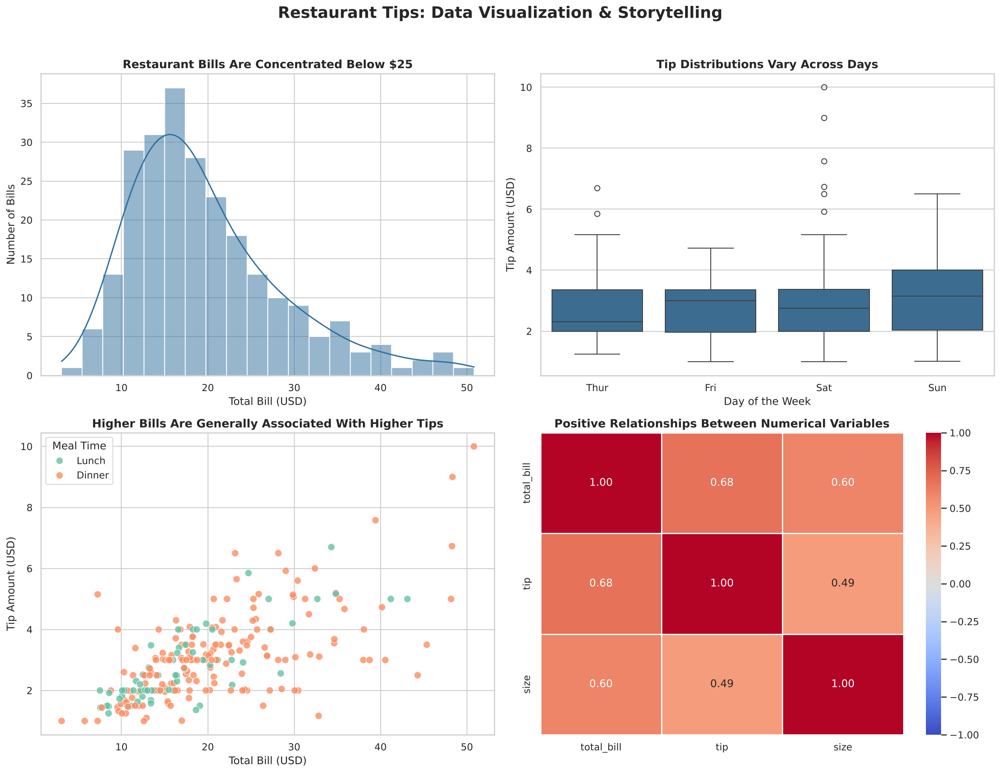

# Data Visualization and Storytelling with Matplotlib & Seaborn

An exploratory data visualization project on the Seaborn *Tips* dataset, using Python, Matplotlib and Seaborn to show how restaurant bills and tips are distributed and how they relate to each other.

[](https://colab.research.google.com/github/BhoomikaJain21/Matplotlib-Seaborn-Data-Storytelling/blob/main/data_visualization_analysis.ipynb)

> **Portfolio series:** this is Project 2 of my Data Analytics portfolio. Project 1 is [Titanic EDA](https://github.com/BhoomikaJain21/Titanic-EDA), which focused on exploratory analysis with summary tables. This project focuses on **choosing, building and interpreting charts**.

---

## Project Overview

Raw tables of restaurant data are hard to read at a glance. This project turns the Tips dataset (244 restaurant bills) into five clear, labelled charts and one combined dashboard. Each chart has a title that states what it shows and a short takeaway backed by numbers from the notebook.

This is a **descriptive** analysis. It does not build predictive models, and it does not claim that any variable *caused* another to change.

## Project Objectives

- Inspect the structure, size and quality of the dataset before visualizing it.
- Show how total restaurant bills are distributed.
- Compare tip amounts across the days of the week.
- Examine the relationship between total bill and tip, distinguishing lunch from dinner.
- Measure the strength of the linear relationships between the numerical variables.
- Combine the main charts into one dashboard and save every chart as an image (150 DPI).
- Keep association and causation clearly separate.

## Research Questions

| # | Question |
|---|---|
| RQ1 | How are total restaurant bills distributed? |
| RQ2 | How are tip amounts distributed? |
| RQ3 | How is the total bill related to the tip amount? |
| RQ4 | Do bills or tips differ across day, meal time or party size? |

> RQ4 is answered most directly for **day**. Meal time and party size are examined more lightly (see *Limitations*).

## Dataset Description

**Source:** the Tips dataset included with [Seaborn](https://seaborn.pydata.org/), loaded with `sns.load_dataset('tips')`. Each row records one restaurant bill and the tip that was left.

| Property | Value |
|---|---|
| Rows | 244 |
| Columns | 7 |
| Missing values | None |
| Duplicate records | 1 pair of identical rows (rows 198 and 202), both retained |

| Column | Description | Type |
|---|---|---|
| `total_bill` | Total bill in US dollars (USD) | Numerical |
| `tip` | Tip in US dollars (USD) | Numerical |
| `size` | Number of people in the party | Numerical |
| `sex` | Sex of the person who paid the bill | Categorical |
| `smoker` | Whether the party included smokers | Categorical |
| `day` | Day of the week (Thur, Fri, Sat, Sun) | Categorical |
| `time` | Meal time (Lunch, Dinner) | Categorical |

**Why both duplicate rows were kept:** identical values do not prove the two rows describe the same transaction. The dataset has no transaction ID or timestamp, and two different parties could plausibly produce the same values.

## Tools and Technologies

| Tool | Purpose |
|---|---|
| Python | Programming language |
| Pandas | Data inspection, quality checks and group summaries |
| Matplotlib | Figure layout, the 2×2 dashboard and saving images |
| Seaborn | Statistical charts (histogram, box plot, bar chart, scatter plot, heatmap) |
| Jupyter Notebook | Interactive environment for the analysis |

## Project Workflow

1. **Inspect the data:** review shape, data types and summary statistics.
2. **Assess data quality:** check for missing values and duplicate records, and document the decision made.
3. **Set a consistent chart theme:** white grid background, primary blue `#2E6F9E`, consistent fonts and USD axis labels.
4. **Build individual charts:** histogram, box plot, bar chart, scatter plot and correlation heatmap.
5. **Check the numbers:** print the statistics behind each chart so each takeaway can be verified.
6. **Combine into a dashboard:** a 2×2 view of the main findings.
7. **Interpret with care:** summarise findings, limitations and next steps, separating association from causation.

## Visualizations Included

| Chart | What it shows | File |
|---|---|---|
| Histogram (20 bins + KDE) | Distribution of total restaurant bills | [`histogram.png`](histogram.png) |
| Box plot | Distribution of tips by day | [`boxplot.png`](boxplot.png) |
| Bar chart | Average tip by day, with 95% confidence intervals | [`bar_chart.png`](bar_chart.png) |
| Scatter plot | Total bill vs tip, coloured by meal time | [`scatter_plot.png`](scatter_plot.png) |
| Correlation heatmap | Pearson correlations between `total_bill`, `tip` and `size` | [`correlation_heatmap.png`](correlation_heatmap.png) |
| 2×2 dashboard | Histogram, box plot, scatter plot and heatmap together | [`tips_dashboard.png`](tips_dashboard.png) |

All charts are saved at 150 DPI.

## Dashboard Preview



## Key Findings

All figures come directly from the notebook's outputs and describe all 244 bills.

**Bills (RQ1)**

- 130 of 244 bills (53.3%) are between $10 and $20, and 188 (77.0%) are below $25.
- The distribution is right-skewed (skewness 1.13): the mean (about $19.79) is above the median (about $17.80), and only 10 bills are $40 or more. The largest bill is $50.81.

**Tips (RQ2)**

- Tips range from $1.00 to $10.00, with a median of $2.90 and a mean of about $3.00.

**Bill and tip (RQ3)**

- Total bill and tip have a positive association (correlation 0.68), which holds within lunch (0.81) and dinner (0.63). The points are widely scattered, so tipping varies a lot between bills.
- Party size is also positively correlated with total bill (0.60) and tip (0.49).

**Differences by day, meal time and party size (RQ4)**

| Day | Bills | Average tip | Median tip |
|---|---|---|---|
| Thursday | 62 | $2.77 | about $2.31 |
| Friday | 19 | $2.73 | $3.00 |
| Saturday | 87 | $2.99 | $2.75 |
| Sunday | 76 | $3.26 | $3.15 |

- Sunday has the highest average and median tip. Thursday has the lowest median, and Friday the lowest average.
- The average tips are close together and their 95% confidence intervals overlap, so the day differences are modest.
- Dinner bills average about $20.80 (tip about $3.10) compared with about $17.17 (tip about $2.73) for lunch.

> **Association, not causation:** these are patterns in observational data. None of the results shows that one variable causes another.

## Project Folder Structure

```
Matplotlib-Seaborn-Data-Storytelling/
│
├── data_visualization_analysis.ipynb
├── histogram.png
├── boxplot.png
├── bar_chart.png
├── scatter_plot.png
├── correlation_heatmap.png
├── tips_dashboard.png
├── README.md
└── requirements.txt
```

## Installation and Execution

### Option 1: Google Colab

1. Click the **Open In Colab** badge at the top of this README.
2. Select **Runtime → Run all**.

Colab already includes pandas, Matplotlib and Seaborn, so nothing needs to be installed. The notebook creates the `outputs/` folder itself.

### Option 2: Run locally with Jupyter Notebook

1. Clone the repository:

   ```
   git clone https://github.com/BhoomikaJain21/Matplotlib-Seaborn-Data-Storytelling.git
   cd Matplotlib-Seaborn-Data-Storytelling
   ```

2. (Optional) Create a virtual environment:

   ```
   python -m venv venv

   # macOS / Linux
   source venv/bin/activate

   # Windows
   venv\Scripts\activate
   ```

3. Install the dependencies:

   ```
   pip install -r requirements.txt
   ```

4. Launch Jupyter Notebook:

   ```
   jupyter notebook
   ```

5. Open `data_visualization_analysis.ipynb` and choose **Kernel → Restart & Run All** (or **Run → Run All Cells** in newer versions).

> **Note:** the first run needs an internet connection so Seaborn can download the dataset. Running the notebook regenerates all six images in `outputs/`.

## Skills Demonstrated

- Choosing the right chart for the question (distribution, comparison, relationship, correlation).
- Building statistical charts with Seaborn and controlling layout with Matplotlib, including a multi-panel dashboard.
- Applying a consistent visual theme: colour, typography, axis labels with units, legends and chart dimensions.
- Writing chart titles that communicate a finding, and backing each takeaway with printed numbers.
- Basic data quality checks and documenting decisions, such as keeping duplicate-looking records.
- Interpreting results carefully: separating association from causation and noting overlapping variables and small groups.
- Organising a reproducible project: notebook, saved outputs, dependency file and README.

## Limitations

- **Small sample:** 244 bills, and some groups are tiny (for example, 19 bills on Friday and 4 to 5 bills for party sizes 1, 5 and 6).
- **Day and meal time overlap:** Thursday is almost entirely lunch (61 of 62 bills) and Saturday and Sunday are dinner only, so their effects cannot be separated.
- **Association, not causation:** correlation measures linear association only and can be influenced by unusual values such as the $10.00 tip.
- **Descriptive methods only:** no significance tests were run.
- **Variables not visualized:** `sex` and `smoker` were not analysed, and `size` appears only in the heatmap and a summary table.
- **Limited background information:** the dataset has no dates or restaurant details, so results should not be generalised beyond it.

## Possible Future Improvements

- Analyse tip as a percentage of the bill.
- Add charts for `sex`, `smoker` and `size`, and a facet grid by day and meal time.
- Add a regression line with a confidence band, and statistical tests across days.
- Repeat the analysis without the duplicate row as a sensitivity check.
- Build interactive versions of the charts with Plotly.

## Author

**Bhoomika Jain**

- GitHub: [BhoomikaJain21](https://github.com/BhoomikaJain21)
- Previous project: [Titanic EDA](https://github.com/BhoomikaJain21/Titanic-EDA)
